# dos-tpdemos

Retro programming in Borland Turbo Pascal 7

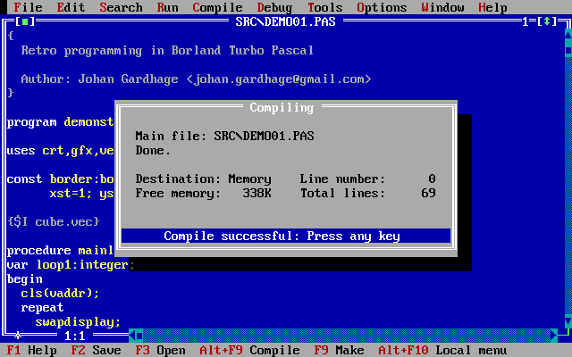

## Prerequisites

To build and run the Borland Turbo Pascal demos, you must first install the following tools:

- [DOSBox Staging](https://www.dosbox-staging.org/)
- [Borland Turbo Pascal](https://winworldpc.com/product/turbo-pascal/7x)

### Install DOSBox Staging

#### Ubuntu

```
$ sudo add-apt-repository ppa:feignint/dosbox-staging
$ sudo apt update
$ sudo apt install dosbox-staging 7zip
```

#### macOS

```
$ brew install dosbox-staging sevenzip
```

#### Configuration

When starting `dosbox-staging` the first time, the configuration file `dosbox-staging.conf` will be generated in

- Ubuntu: `~/.config/dosbox/dosbox-staging.conf`
- macOS: `~/Library/Preferences/DOSBox/dosbox-staging.conf`

### Install Borland Turbo Pascal

1. Download [Borland Turbo Pascal 7.01 (3.5-720k).7z](https://dl.winworldpc.com/Borland%20Turbo%20Pascal%207.01%20(3.5-720k).7z)
   ```
   $ curl -o "Borland Turbo Pascal 7.01 (3.5-720k).7z" "https://dl.winworldpc.com/Borland%20Turbo%20Pascal%207.01%20(3.5-720k).7z"
   ```

1. Extract the downloaded Borland Turbo Pascal archive
   ```
   $ 7zz x "Borland Turbo Pascal 7.01 (3.5-720k).7z"
   ```

1. Extract the Borland Turbo Pascal disk images
   ```
   $ cd "Borland Turbo Pascal 7.01 (3.5-720k)"/
   $ for i in *.img; do echo $i; 7zz x -y -otpsetup $i; done
   ```

1. Move the extracted files to the DOS C: drive
   ```
   $ mkdir -p ~/DOSBox
   $ mv tpsetup ~/DOSBox/
   ```

1. Configure DOSBox Staging

   Edit `dosbox-staging.conf` (see [Configuration](#configuration)) and add the following autoexec options
   ```
   [autoexec]
   mount c ~/DOSBox
   path %PATH%;C:\TP\BIN
   c:
   ```

   The default CPU speed (`cpu_cycles = 3000`) is too slow for the demos. In the `[cpu]` section, change it to
   ```
   [cpu]
   cpu_cycles = max
   ```

1. Start `dosbox-staging` and execute the Borland Turbo Pascal installation program
   ```
   $ dosbox-staging
   C:\> cd tpsetup
   C:\TPSETUP> install.exe
   ```
   In the installation program, select the following options
   ```
   Enter the SOURCE drive to use: C
   Enter the SOURCE Path: \TPSETUP
   Install Turbo Pascal on a Hard Drive
   Start Installation
   ```

## Build demos

Link the `dos-tpdemos` git repository to the DOS C: drive
```
$ ln -s ~/git/dos-tpdemos ~/DOSBox/tpdemos
```

#### Build demos from DOS terminal

1. Execute build script
   ```
   C:\TPDEMOS> buildall.bat
   ```
   The demos will be located in the `C:\TPDEMOS\BUILD` directory

1. Run demo
   ```
   C:\TPDEMOS> build\demo01.exe
   ```

#### Build demos from Borland Turbo Pascal IDE

1. Start Borland Turbo Pascal IDE
   ```
   C:\TPDEMOS> turbo
   ```

1. Configure Borland Turbo Pascal

   Press `ALT+O` for options

   Select `Directories` and type in the following directories
   ```
   EXE & TPU directory: C:\TPDEMOS\BUILD
   Include directories: C:\TPDEMOS\ASSETS
   Unit directories: C:\TP\UNITS;C:\TPDEMOS\SRC\LIB
   ```

   Select `Compiler` and the following options
   ```
   [X] 286 instructions
   ```

   Select `Environment`, `Preferences` and the following options
   ```
   [ ] Auto save
   [ ] Change dir on open
   ```

   Select `Environment`, `Editor` and the following options
   ```
   [ ] Create backup files
   ```

   Select `Save`

1. Open demo source file

   Press `F3` to open file

1. Build demo source file

   Press `F9` to build file

1. Run demo

   Press `ALT+R` and `R` to run demo

## License

Licensed under MIT license. See [LICENSE](LICENSE) for more information.

## Authors

* Johan Gardhage

## Screenshots

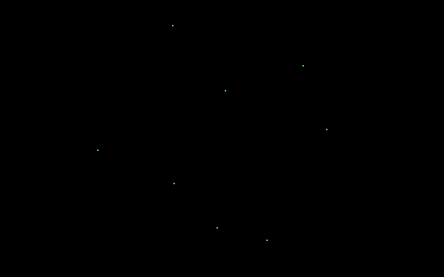
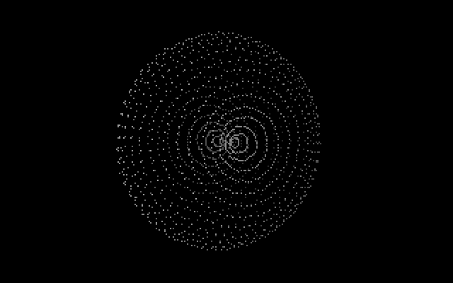
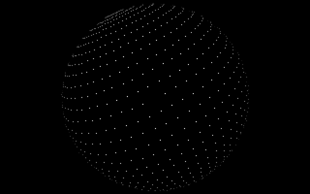
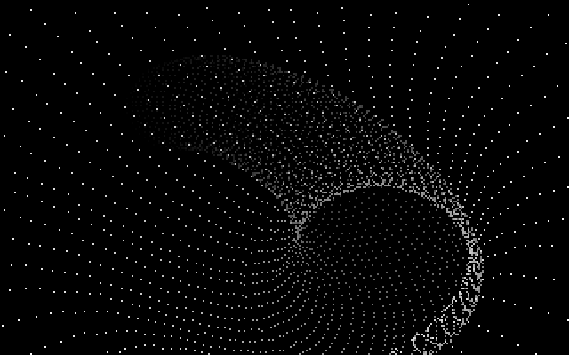
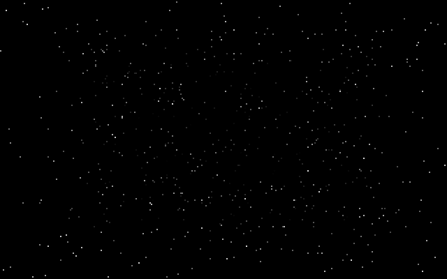

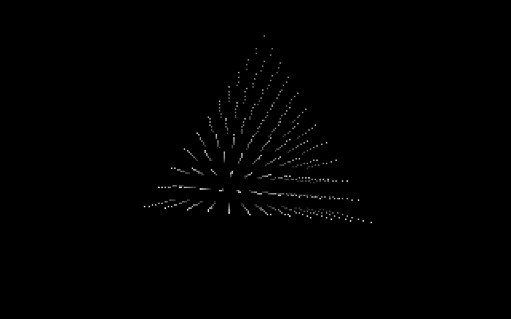
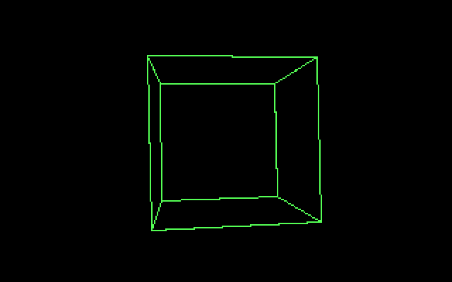
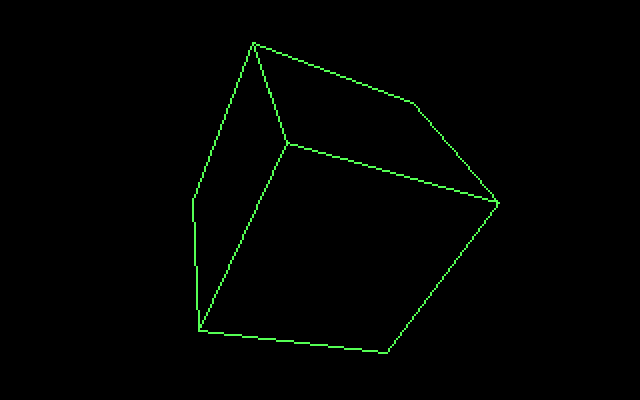
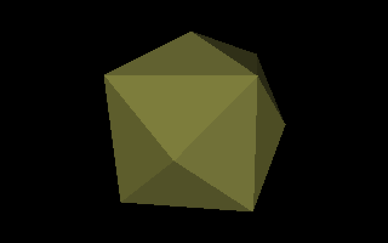
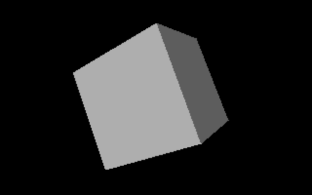
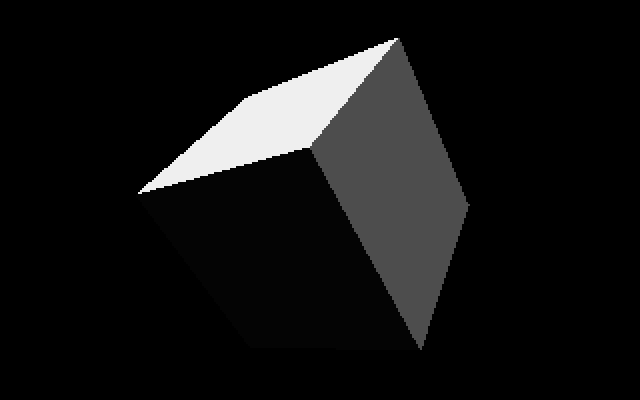
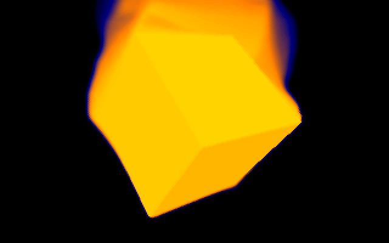
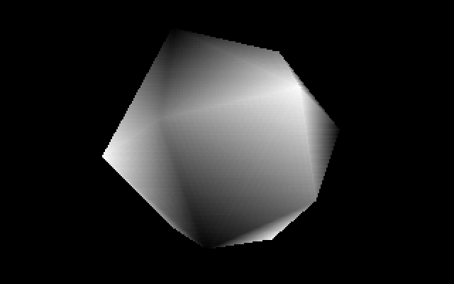
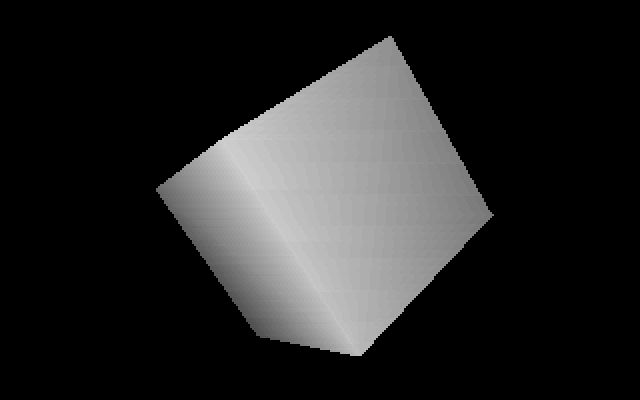
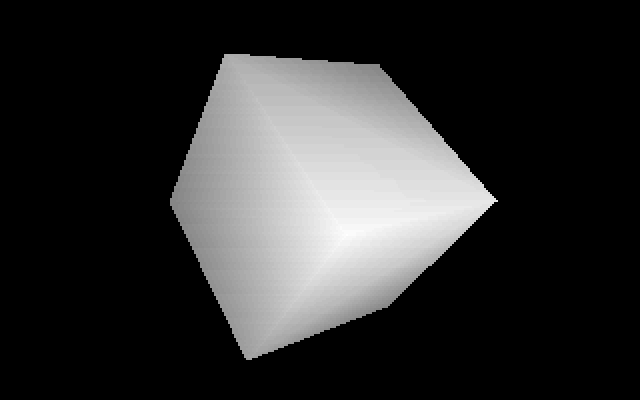
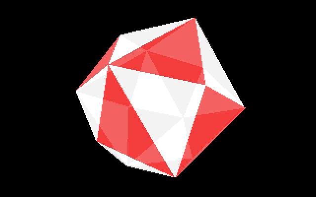
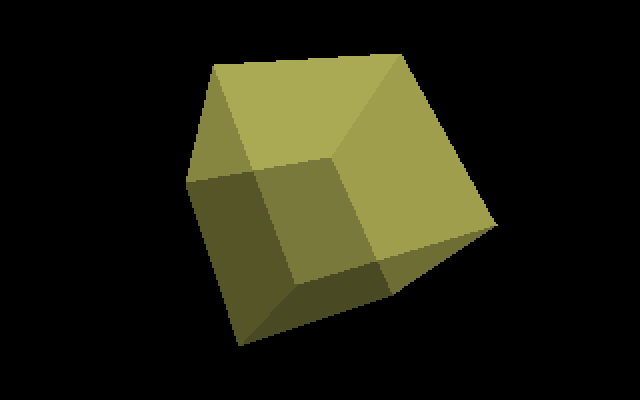
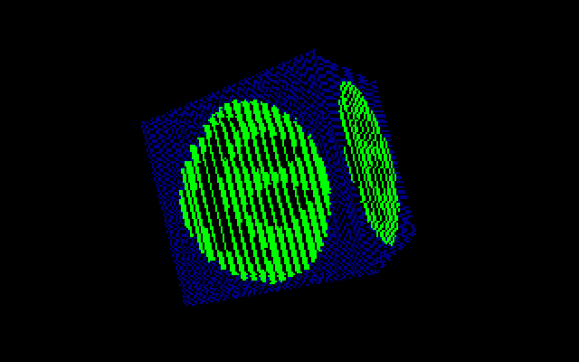

